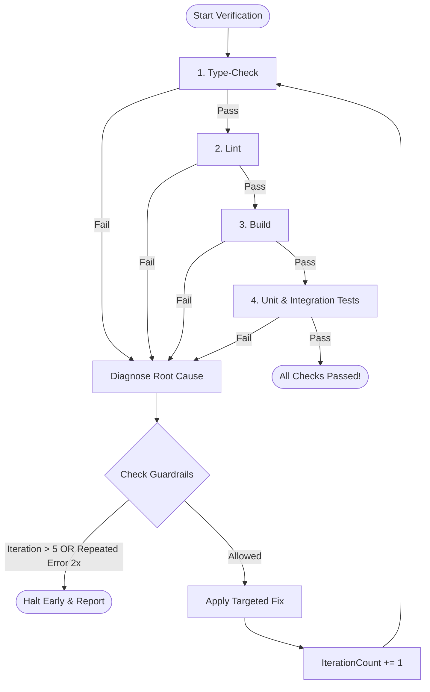

# Iterative Error Fix Workflow

A structured, resilient protocol for continuously running project verification checks, diagnosing failures, applying root-cause fixes, and re-verifying until the entire project passes cleanly.

---

## 1. When to Use

Activate this skill in any of the following scenarios:
- **Post-Edit Verification**: Immediately after writing, generating, refactoring, or modifying source files.
- **Explicit User Request**: Whenever the user asks to "verify and fix errors", "make sure tests pass", "fix build failures", "run lint and typecheck", or "check for errors".
- **Pre-Commit / Pre-Push Sanity Gate**: Prior to staging git commits, deploying releases, or pushing changes to remote branches.
- **Dependency Upgrades / Migrations**: After updating libraries, packages, schemas, or compiler versions.

---

## 2. Auto-Detect Verification Commands

Before running checks, inspect project configuration files in the workspace root to auto-detect the available commands across the project's stack. Inspect files in the following priority order:

### A. JavaScript / TypeScript / Node.js (`package.json`)
Read `package.json` and examine `scripts`:
| Check Phase | Typical Script Keys | Fallback Shell Command |
|---|---|---|
| **Type-Check** | `type-check`, `typecheck`, `check-types`, `tsc` | `npx tsc --noEmit` (if `tsconfig.json` exists) |
| **Lint** | `lint`, `lint:fix`, `eslint`, `check` | `npx eslint .` / `npx biome check .` / `npx oxlint` |
| **Build** | `build`, `compile`, `bundle` | `npm run build` / `npx vite build` / `npx tsc` |
| **Test** | `test`, `test:run`, `test:unit`, `jest`, `vitest` | `npm test -- --watchAll=false` / `npx vitest run` |

> *Note: Adapt package runner based on lockfiles present: `pnpm` (`pnpm-lock.yaml`), `yarn` (`yarn.lock`), `bun` (`bun.lockb`), or `npm` (`package-lock.json`).*

### B. Python (`pyproject.toml`, `setup.cfg`, `requirements.txt`, `Pipfile`)
| Check Phase | Detected Tool / Config | Command |
|---|---|---|
| **Type-Check** | `mypy`, `pyright` in `pyproject.toml` | `mypy .` or `pyright` |
| **Lint / Format** | `ruff`, `flake8`, `black`, `pylint` | `ruff check .` or `flake8` |
| **Build** | `poetry`, `flit`, `hatch`, `setuptools` | `python -m build` or `poetry build` |
| **Test** | `pytest`, `unittest` | `pytest` or `python -m unittest discover` |

### C. Rust (`Cargo.toml`)
| Check Phase | Tool | Command |
|---|---|---|
| **Type-Check** | `cargo check` | `cargo check --all-targets` |
| **Lint** | `clippy` | `cargo clippy --all-targets -- -D warnings` |
| **Build** | `cargo build` | `cargo build` |
| **Test** | `cargo test` | `cargo test` |

### D. Go (`go.mod`)
| Check Phase | Tool | Command |
|---|---|---|
| **Type-Check / Lint** | `go vet`, `golangci-lint` | `go vet ./...` or `golangci-lint run` |
| **Build** | `go build` | `go build ./...` |
| **Test** | `go test` | `go test -v ./...` |

### E. Monorepos, Makefiles & CI Workflows
- Check `Makefile` or `Taskfile.yml` for targets: `make check`, `make lint`, `make test`, `make build`.
- Check `.github/workflows/*.yml` to inspect exact flags, environment variables, and commands executed in CI.
- Monorepo tooling: `turbo run check`, `nx run-many -t lint,test,build`, `pnpm -r test`.

*If a specific phase is not configured in the project (e.g., pure JavaScript without TypeScript), mark that phase as **[SKIPPED]** and proceed to the next active phase.*

---

## 3. Iterative Verification Loop (Max 5 Attempts)

Execute the verification and repair process through an iterative feedback loop:



### Execution Steps per Iteration:

1. **Sequential Order of Execution**:
   - Always run the verification suite in strict order:
     1. **Type-Check**: Fastest filter; catches syntactic flaws, type incompatibilities, missing imports, and broken signatures before heavier compilation.
     2. **Lint**: Enforces code style, catches unused imports/variables, variable shadowing, and anti-patterns.
     3. **Build**: Ensures the whole package bundles, compiles, and transpiles without bundler/linker errors.
     4. **Tests**: Validates runtime behavior, unit contracts, integration flows, and business logic.
   - If any step fails, **halt the sequence immediately**—do not run downstream tests when upstream compilation or typing is broken.

2. **Zero-Error Early Exit**:
   - If all active checks finish with exit code `0` (zero errors), stop immediately. Confirm full success and produce the final summary.

3. **In-Depth Diagnosis & Root-Cause Identification**:
   - Read the complete compiler/runtime stdout, stderr, and stack traces.
   - Trace backwards from the call stack to find the original faulty file, function, and line.
   - Differentiate the **symptom** (e.g., `Cannot read property of undefined`) from the **root cause** (e.g., unhandled nullable return, missing parameter, stale state).

4. **Targeted, Surgical Code Fixing**:
   - Apply clean, minimal, targeted fixes to solve the root problem.
   - Never make sprawling unnecessary rewrites that could introduce secondary defects.
   - Update related tests or mock definitions only if the underlying API signature legitimately changed.

5. **Strict Anti-Masking Policy (Zero Toleration for Hiding Errors)**:
   - **NEVER** disable linting rules or silence warnings using directives like `// eslint-disable`, `# noqa`, `// @ts-ignore`, or `// @ts-expect-error` to hide legitimate bugs.
   - **NEVER** delete, skip, or comment out failing tests (`test.skip()`, `it.skip()`, `xit()`, `/* test(...) */`).
   - **NEVER** weaken test assertions (e.g., relaxing `expect(res.status).toBe(200)` to `expect(true).toBe(true)` or removing validation asserts).
   - **NEVER** alter build/typecheck configurations to become less strict (e.g., turning off `noImplicitAny`, disabling `strictNullChecks`, or excluding files from compilation).
   - *Every error must be fixed properly in the code itself.*

---

## 4. Loop Guardrails

To prevent infinite loops, token exhaustion, or spinning on stubborn obstacles, enforce strict guardrails:

### Guardrail 1: Hard Iteration Cap (Max 5 Iterations)
- Maintain an iteration counter `iteration` starting at `1`.
- If the suite has not passed cleanly by the end of iteration 5, **halt execution immediately**.
- Summarize the remaining failures, the interventions attempted, and recommendations for manual resolution.

### Guardrail 2: Identical Error Stagnation (2-Strike Rule)
- Maintain an `error_fingerprint` across iterations:
  - `Fingerprint = (FailingPhase, ErrorCode/Type, TargetFile, LineNumber, ExactErrorMessage)`
- If the **identical error fingerprint** is observed **2 iterations in a row** without progress:
  - **Halt immediately**. Do not attempt a 3rd identical or ineffective fix.
  - Explain explicitly:
    - What the error is.
    - What fix was attempted in iteration $N-1$ and why it failed to resolve it.
    - Why the issue cannot be resolved through local targeted edits (e.g., external dependency bug, missing native binary, conflicting environment variables, circular dependency).
    - Provide a clear, actionable recommendation or ask the user for architectural input.

---

## 5. Final Summary Format

When the loop concludes (either upon full success or triggered guardrail), output a structured markdown summary in the following format:

```markdown
### Iterative Error Fix Summary

- **Total Iterations Run**: X / 5
- **Final Status**: [PASSED CLEANLY | HALTED BY GUARDRAIL]

#### Verification Suite Status
| Check Phase | Command Executed | Status | Details |
|---|---|---|---|
| Type-Check | `<command>` | PASSED / SKIPPED / FAILED | Zero type errors |
| Lint | `<command>` | PASSED / SKIPPED / FAILED | Zero lint violations |
| Build | `<command>` | PASSED / SKIPPED / FAILED | Clean build output |
| Tests | `<command>` | PASSED / SKIPPED / FAILED | X / X tests passed |

#### Resolved Errors & Root-Cause Analysis
1. **Error 1: [Short Title]**
   - **Location**: `path/to/file.ext:line`
   - **Error Message**: `<exact error snippet>`
   - **Root Cause**: Explanation of why the failure occurred.
   - **Fix Applied**: Description of code change made.
   - **Resolution Iteration**: Resolved in Iteration N.

#### Files Modified
- `path/to/file1.ext` (Lines X-Y)
- `path/to/file2.ext` (Lines A-B)
```
