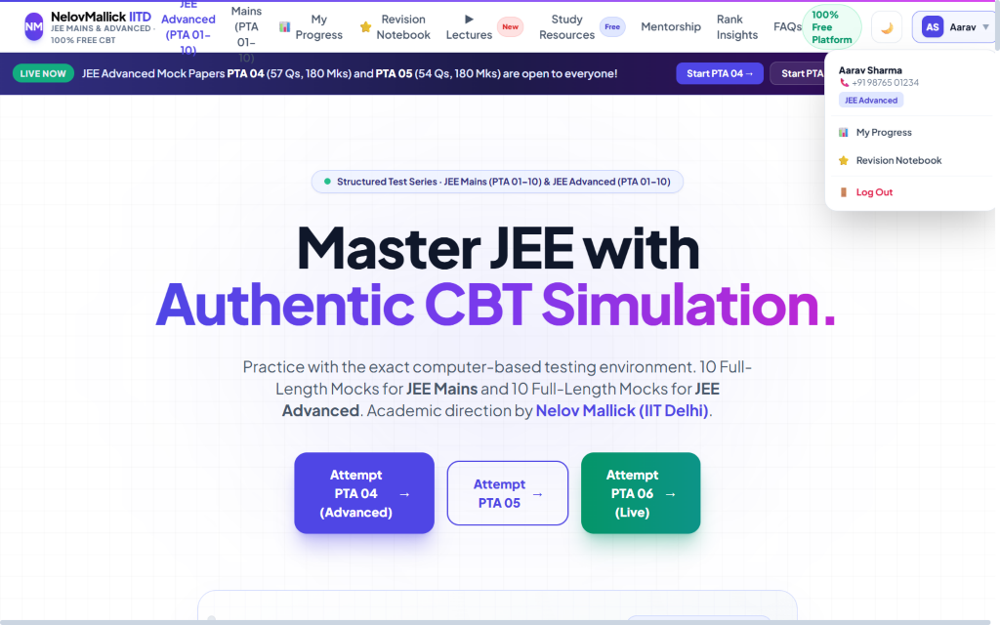
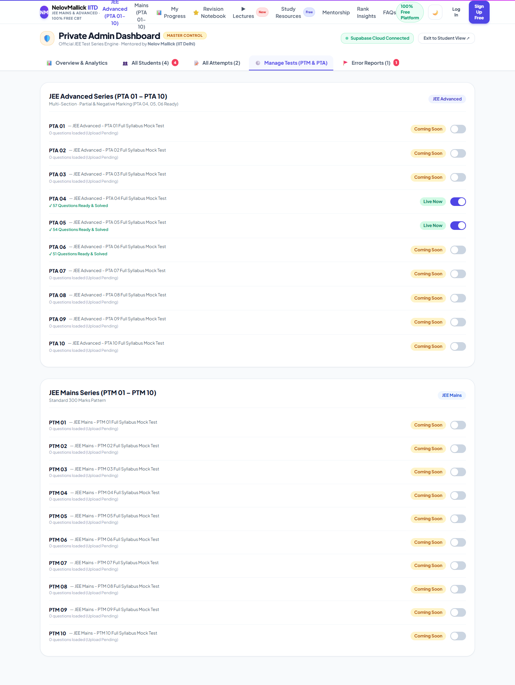

# NelovMallickIITD · Authentic JEE Advanced & Mains CBT Platform

Official JEE examination preparation portal curated and mentored by **Nelov Mallick (IIT Delhi)**. Provides an authentic Computer-Based Test (CBT) examination environment, high-yield full-syllabus mock papers (**PTA-04**, **PTA-05**, **PTA-06**, **PTM 01–10**), official partial marking simulation, mathematical KaTeX rendering, 2,000+ video lectures, study resources, 3D tilt interface, and instant diagnostic performance analytics.

**100% Free Open Educational Initiative · Zero Paywalls · Zero Paid SMS Costs**

- **Live Production URL**: [https://nelovmallickiitd-web.vercel.app](https://nelovmallickiitd-web.vercel.app)
- **GitHub Repository**: [https://github.com/NEEL-IITD/nelovmallickiitd-cbt](https://github.com/NEEL-IITD/nelovmallickiitd-cbt)
- **Academic Director & Mentor**: Nelov Mallick (IIT Delhi)

---

## 🚀 Key Features

### 1. Flexible Authentication Engine (Gmail OR Name + Contact Number)
- **Option A — Gmail / Google Sign-In**:
  - One-click **Continue with Google** (`signInWithOAuth`).
  - Standard Email + Password. Contact number is optional when using `@gmail.com`.
  - **Dynamic Mandatory Rule**: Any non-`@gmail.com` address (e.g. `@yahoo.com`, `@outlook.com`) automatically requires a validated 10-digit mobile number with `+91` prefix before registration.
- **Option B — Name & Contact Number (No Gmail Needed, Zero SMS Cost)**:
  - Register with **Full Name**, **10-Digit Mobile Number**, and **Password / 6-Digit PIN**.
  - Maps to a deterministic internal Supabase Auth identifier behind the scenes while cleanly displaying the real Full Name and `+91 XXXXX XXXXX` across the navbar, profile dropdown, scorecard, and admin views.
  - Zero paid SMS/Twilio costs — 100% free forever.

### 2. Full-Visibility Private Admin Dashboard (`/admin`)
Accessible when logging in with Admin Gmail (`nelovmallick@gmail.com` / `YOUR_ADMIN_EMAIL@gmail.com`):
- **Overview Tab**: 6 KPI cards (Total Students by Gmail vs Phone, Submissions by PTM vs PTA, Lectures Completed, Bookmarks Saved, Live Active Tests `X/20`, Open Reports), test submissions chart, and live activity feed.
- **All Students Directory Tab**: Search by Name, Gmail, or Phone; filter by login method and target exam; one-click contact number copying (`📋`); interactive **Student Detail Drawer/Modal**; and instant **"Export Students CSV"** button.
- **All Test Attempts Tab**: Filterable logs showing marks scored, percentage, accuracy, and predicted All India Rank (AIR).
- **Manage Tests Tab**: Live toggles for **JEE Advanced (PTA 01–10)** and **JEE Mains (PTM 01–10)** with 0-question safeguard modals.
- **Error Reports Inbox Tab**: Tickets display the reporter's Name, Gmail, and **Contact Number**.

### 3. Full-Length Authentic CBT Mock Series
- **JEE Advanced (PTA 01–10)**:
  - **PTA-04 (Paper 1)**: 57 Questions | 180 Marks | 180 Minutes (Multi-Section with partial marking)
  - **PTA-05 (Paper 2)**: 54 Questions | 180 Marks | 180 Minutes (Matching List & Numerical)
  - **PTA-06 (Comprehensive)**: 51 Questions | 180 Marks | 180 Minutes (Full Syllabus)
- **JEE Mains (PTM 01–10)**:
  - Full 300 marks standard NTA pattern mock papers.
- **Attempt Limit**: Strictly limited to 3 attempts per test to maintain competitive discipline.

### 4. Video Lectures & Study Resources Hub
- 2,000+ curated YouTube/Instagram concept walkthroughs & problem analysis.
- Chapter revision notes, formula sheets, and personal Revision Notebook.
- Interactive 3D tilt effect cards on desktop.

---

## 📸 Screenshots & Proof of Verification

| Dynamic Mandatory Contact Number | Student Profile Dropdown (Clean Phone Display) |
|---|---|
|  |  |

| Admin Dashboard Overview | All Students Directory with CSV Export |
|---|---|
|  |  |

| Student Detail Drawer Modal | Manage Tests (PTM 01-10 & PTA 01-10) |
|---|---|
|  |  |

---

## 🛠️ Database Setup (Supabase)

1. Open **Supabase Dashboard → SQL Editor**.
2. Run the idempotent migration script located at:
   `supabase/migrations/2026_contact_number_auth_and_full_admin.sql`
3. In **Authentication → Providers → Email**, ensure **"Confirm email"** is toggled **OFF** so contact-number students can start attempting tests immediately without email confirmation roadblocks.

---

## 💻 Local Development

```bash
# Clone the repository
git clone https://github.com/NEEL-IITD/nelovmallickiitd-cbt.git
cd nelovmallickiitd-cbt

# Install dependencies
npm install

# Start local development server
npm run dev

# Build for production
npm run build

# Preview production build locally
npm run preview
```

---

## 🛡️ License & Direction

Academic direction, test curation, and lecture series by **Nelov Mallick (IIT Delhi)**.  
Released as a 100% free platform for JEE Mains & Advanced aspirants across India.
