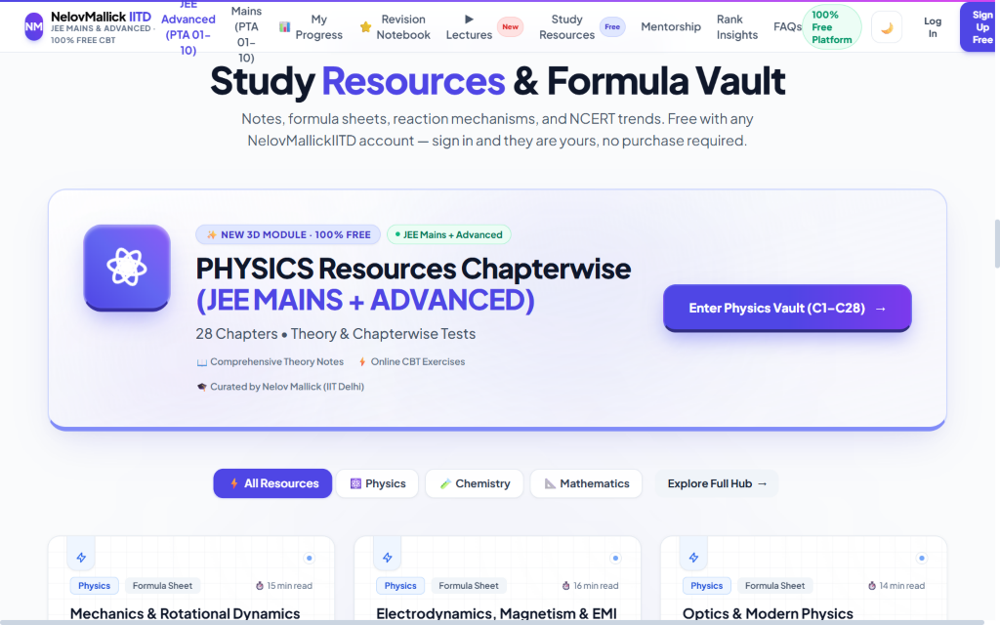
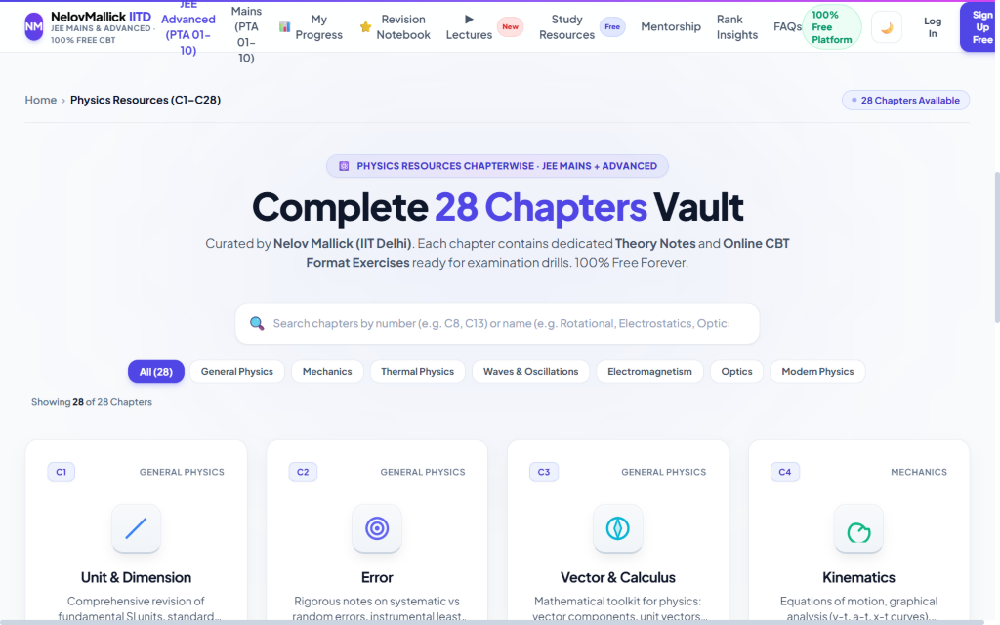
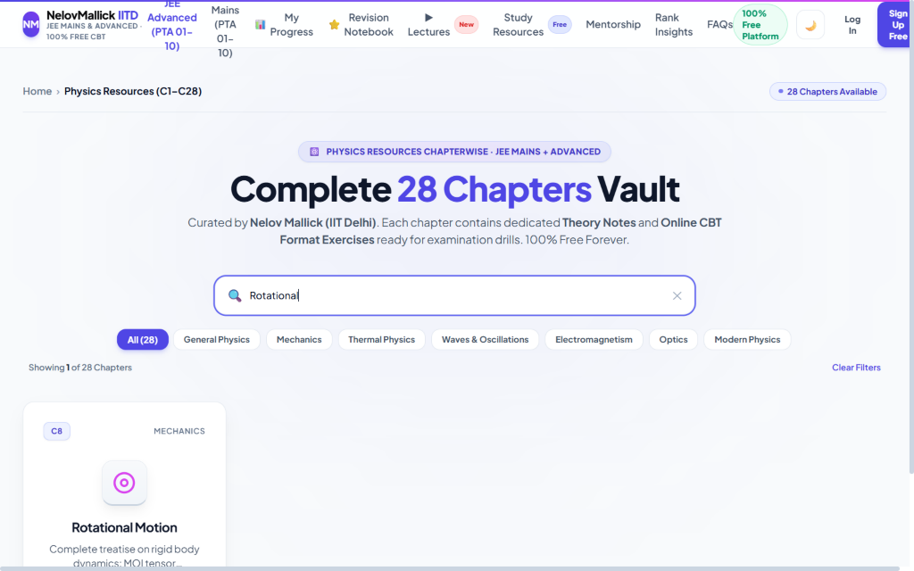
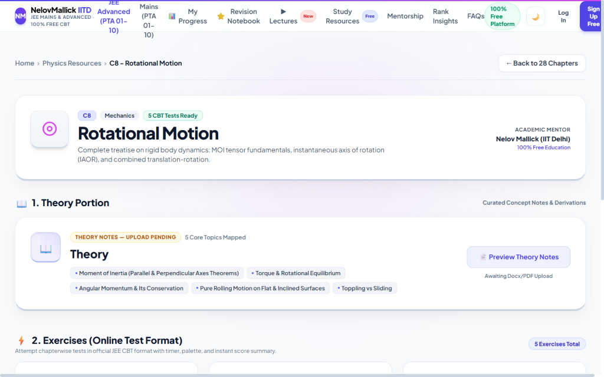
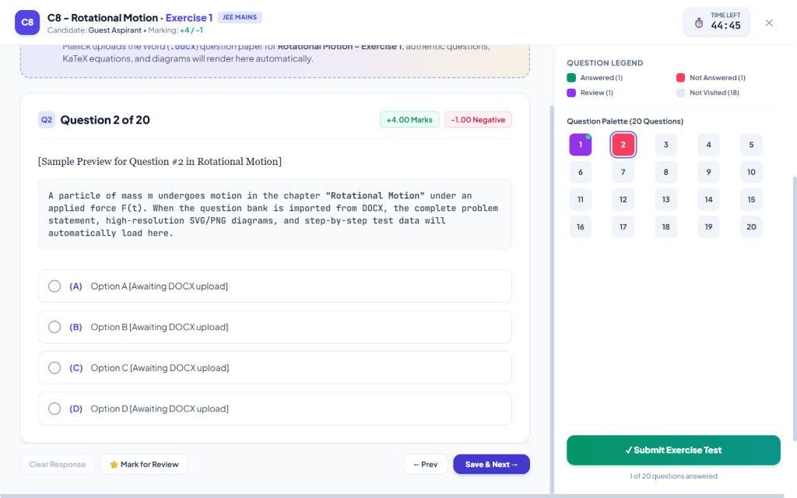
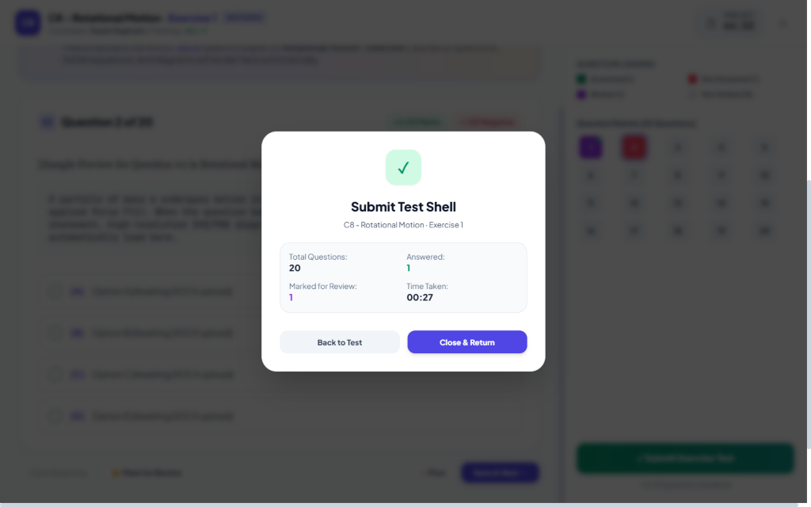
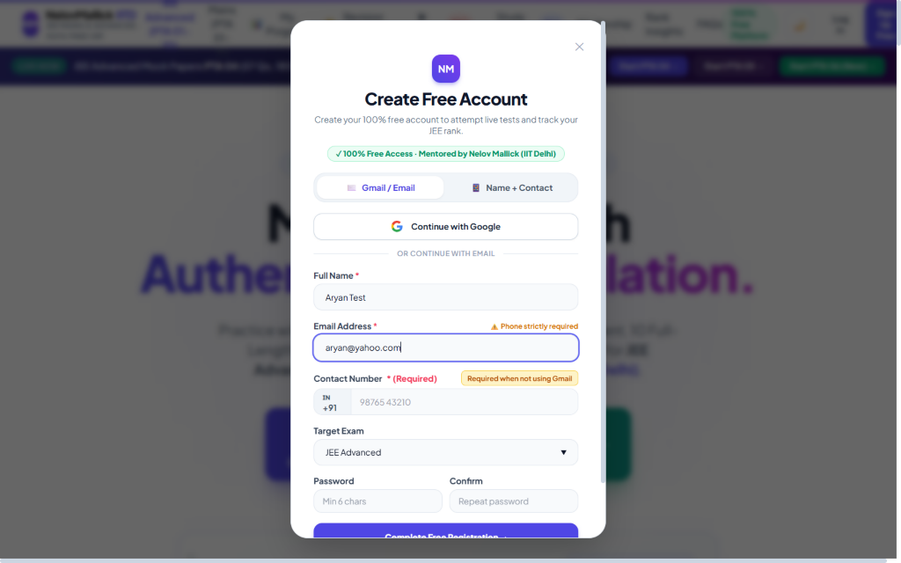
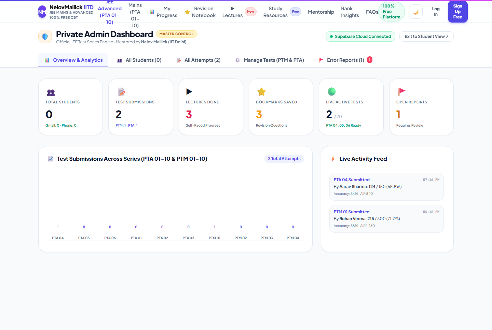
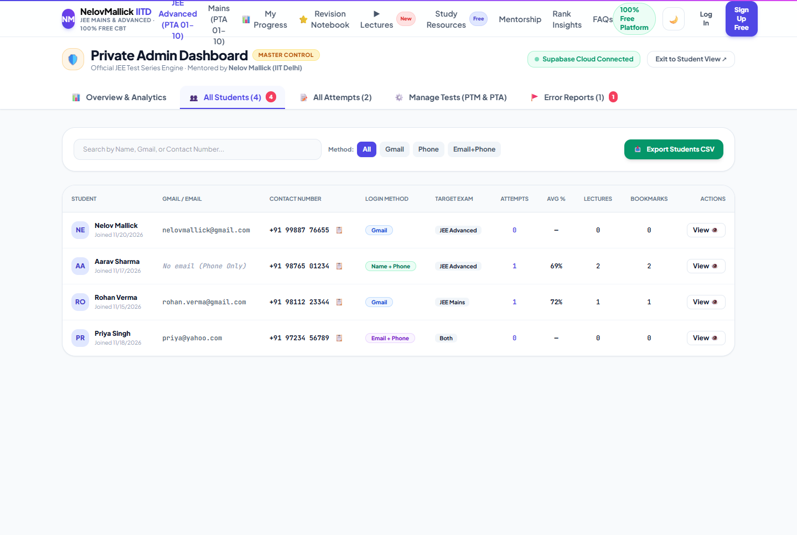
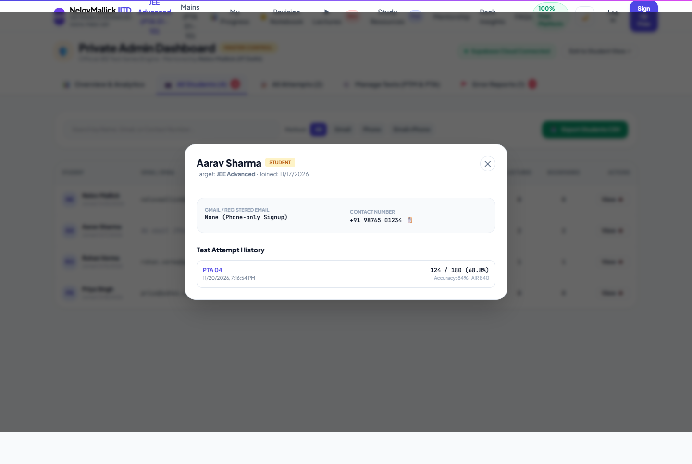

# NelovMallickIITD · Authentic JEE Advanced & Mains CBT Platform

Official JEE examination preparation portal curated and mentored by **Nelov Mallick (IIT Delhi)**. Provides an authentic Computer-Based Test (CBT) examination environment, high-yield full-syllabus mock papers (**PTA-04**, **PTA-05**, **PTA-06**, **PTM 01–10**), official partial marking simulation, mathematical KaTeX rendering, 2,000+ video lectures, study resources, 3D tilt interface, and instant diagnostic performance analytics.

**100% Free Open Educational Initiative · Zero Paywalls · Zero Paid SMS Costs**

- **Live Production URL**: [https://nelovmallickiitd-web.vercel.app](https://nelovmallickiitd-web.vercel.app)
- **GitHub Repository**: [https://github.com/NEEL-IITD/nelovmallickiitd-cbt](https://github.com/NEEL-IITD/nelovmallickiitd-cbt)
- **Academic Director & Mentor**: Nelov Mallick (IIT Delhi)

---

## 🚀 Key Features

### 1. Flexible Authentication Engine (Gmail OR Name + Contact Number)
- **Option A — Gmail / Google Sign-In**:
  - One-click **Continue with Google** (`signInWithOAuth`).
  - Standard Email + Password. Contact number is optional when using `@gmail.com`.
  - **Dynamic Mandatory Rule**: Any non-`@gmail.com` address (e.g. `@yahoo.com`, `@outlook.com`) automatically requires a validated 10-digit mobile number with `+91` prefix before registration.
- **Option B — Name & Contact Number (No Gmail Needed, Zero SMS Cost)**:
  - Register with **Full Name**, **10-Digit Mobile Number**, and **Password / 6-Digit PIN**.
  - Maps to a deterministic internal Supabase Auth identifier behind the scenes while cleanly displaying the real Full Name and `+91 XXXXX XXXXX` across the navbar, profile dropdown, scorecard, and admin views.
  - Zero paid SMS/Twilio costs — 100% free forever.

### 2. Full-Visibility Private Admin Dashboard (`/admin`)
Accessible when logging in with Admin Gmail (`nelovmallick@gmail.com` / `YOUR_ADMIN_EMAIL@gmail.com`):
- **Overview Tab**: 6 KPI cards (Total Students by Gmail vs Phone, Submissions by PTM vs PTA, Lectures Completed, Bookmarks Saved, Live Active Tests `X/20`, Open Reports), test submissions chart, and live activity feed.
- **All Students Directory Tab**: Search by Name, Gmail, or Phone; filter by login method and target exam; one-click contact number copying (`📋`); interactive **Student Detail Drawer/Modal**; and instant **"Export Students CSV"** button.
- **All Test Attempts Tab**: Filterable logs showing marks scored, percentage, accuracy, and predicted All India Rank (AIR).
- **Manage Tests Tab**: Live toggles for **JEE Advanced (PTA 01–10)** and **JEE Mains (PTM 01–10)** with 0-question safeguard modals.
- **Error Reports Inbox Tab**: Tickets display the reporter's Name, Gmail, and **Contact Number**.

### 3. Full-Length Authentic CBT Mock Series
- **JEE Advanced (PTA 01–10)**:
  - **PTA-04 (Paper 1)**: 57 Questions | 180 Marks | 180 Minutes (Multi-Section with partial marking)
  - **PTA-05 (Paper 2)**: 54 Questions | 180 Marks | 180 Minutes (Matching List & Numerical)
  - **PTA-06 (Comprehensive)**: 51 Questions | 180 Marks | 180 Minutes (Full Syllabus)
- **JEE Mains (PTM 01–10)**:
  - Full 300 marks standard NTA pattern mock papers.
- **Attempt Limit**: Strictly limited to 3 attempts per test to maintain competitive discipline.

### 4. Video Lectures & Study Resources Hub
- 2,000+ curated YouTube/Instagram concept walkthroughs & problem analysis.
- Chapter revision notes, formula sheets, and personal Revision Notebook.
- Interactive 3D tilt effect cards on desktop.

### 5. Physics Resources Chapterwise Module (TestonGo 3D Aesthetic)
- **Level 1 (Main Entry 3D Box)**: Standalone 3D card titled **`PHYSICS Resources Chapterwise (JEE MAINS + ADVANCED)`** with subtitle `28 Chapters • Theory & Chapterwise Tests`, atomic 3D icon, and smooth transition into the Physics Vault.
- **Level 2 (28 Chapter 3D Boxes Grid)**: Complete 28 chapters (C1 to C28) displayed in tactile 3D boxes with chapter code badges, distinct physics symbols, metadata tags, unit category filters (`Mechanics`, `General Physics`, `Thermal Physics`, `Electromagnetism`, etc.), and a real-time search bar.
- **Level 3 (Inside Chapter: Theory + CBT Exercises)**:
  - **Theory Portion**: Dedicated 3D box titled `Theory` (e.g. `Theory (NLM, Friction, Constraint)`) with `Theory Notes — Upload Pending` status and topic preview.
  - **Exercises (Online Test Format)**: Individual 3D boxes for every exercise belonging to that chapter with `Coming Soon / Ready for Upload` status.
  - **CBT Test Interface Shell**: Reusable full-fidelity CBT testing environment with live countdown timer, 25-question palette, answer selection, Mark for Review, and submission score summary—fully primed for Word (`.docx`) question uploads.

---

## 📸 Screenshots & Proof of Verification

| Level 1: Standalone Physics 3D Entry Card | Level 2: 28 Chapter 3D Boxes Grid |
|---|---|
|  |  |

| Level 2: Real-Time Chapter Search Filter | Level 3: Chapter Detail & Theory/Exercises (C8) |
|---|---|
|  |  |

| CBT Test Interface Shell (Live Timer & Palette) | Test Submission & Instant Summary Modal |
|---|---|
|  |  |

| Dynamic Mandatory Contact Number | Student Profile Dropdown (Clean Phone Display) |
|---|---|
|  |  |

| Admin Dashboard Overview | All Students Directory with CSV Export |
|---|---|
|  |  |

| Student Detail Drawer Modal | Manage Tests (PTM 01-10 & PTA 01-10) |
|---|---|
|  |  |

---

## 🛠️ Database Setup (Supabase)

1. Open **Supabase Dashboard → SQL Editor**.
2. Run the idempotent migration script located at:
   `supabase/migrations/2026_contact_number_auth_and_full_admin.sql`
3. In **Authentication → Providers → Email**, ensure **"Confirm email"** is toggled **OFF** so contact-number students can start attempting tests immediately without email confirmation roadblocks.

---

## 💻 Local Development

```bash
# Clone the repository
git clone https://github.com/NEEL-IITD/nelovmallickiitd-cbt.git
cd nelovmallickiitd-cbt

# Install dependencies
npm install

# Start local development server
npm run dev

# Build for production
npm run build

# Preview production build locally
npm run preview
```

---

## 🤖 Installed Autonomous Agent & Workflow Skills

The repository is pre-configured with industry-standard autonomous engineering skills:

| Skill | Role / Purpose | Trigger / Commands |
|---|---|---|
| **Get Shit Done (GSD)** | Breaks complex features into small, bite-sized phases (Plan → Execute → Verify) with zero context rot. | `/gsd:new-project`, `/gsd:plan-phase`, `/gsd:execute-phase` |
| **Roo Code** | Multi-model auto-switching. Seamlessly falls back to secondary models upon quota/rate limits (`429`, `RESOURCE_EXHAUSTED`) without stopping work. | Automatic on rate limits; `@skills/roo-code` |
| **Ralph Loop** | Relentless execution mode that loops continuously, self-verifying until all objectives and tests pass without quitting. | `/ralph`, `@skills/ralph-loop-workflow` |
| **CodeRabbit** | Real-time AI code reviewer catching bugs, security vulnerabilities, and logic flaws prior to git commit. | `coderabbit review --agent`, `@skills/code-review` |
| **Frontend Design** | Anthropic production frontend guidelines, responsive design, micro-interactions. | `@skills/frontend-design` |
| **UI/UX Pro Max** | High-end visual aesthetics, typography, accessibility, and modern design systems. | `@skills/ui-ux-pro-max` |
| **Taste Skill** | Modern refined typography, whitespace, and color palette curation. | `@skills/design-taste-frontend` |
| **Impeccable** | Pixel-perfect polish and frontend execution standards. | `@skills/impeccable` |
| **Web Design Guidelines** | Vercel Labs web design benchmarks and high-performance Web standards. | `@skills/web-design-guidelines` |

### 6. Continuous Deployment & Auto-Sync Pipeline
- **Real-Time Workspace Watcher (`npm run sync:watch`)**: Detects any changes across the workspace, auto-stages files, creates structured git commits, and auto-pushes to GitHub `origin/main`.
- **Instant Production Sync (`npm run sync`)**: Runs TypeScript verification, creates the production build, and deploys directly to Vercel global CDN with zero manual interventions.

---

## 🛡️ License & Direction

Academic direction, test curation, and lecture series by **Nelov Mallick (IIT Delhi)**.  
Released as a 100% free platform for JEE Mains & Advanced aspirants across India.
<!-- Antigravity Auto-Sync Enabled -->
